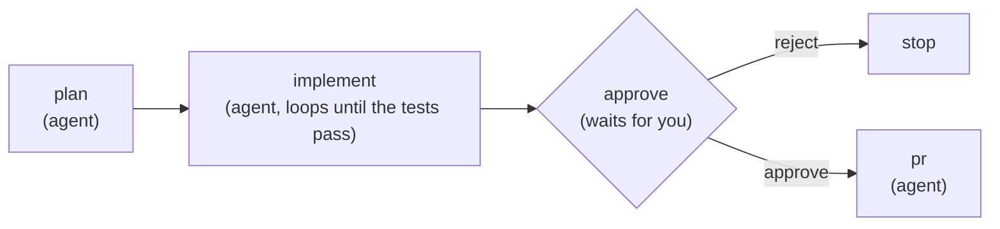

<p align="center">
  
</p>

<h1 align="center">Archon</h1>

<p align="center">
  The simplest way to build the software that builds your software.<br/>
  YAML workflows that can do anything.
</p>

<p align="center">
  <a href="https://trendshift.io/repositories/13964" target="_blank"></a>
</p>

<p align="center">
  <a href="LICENSE"></a>
  <a href="https://github.com/coleam00/Archon/actions/workflows/test.yml"></a>
  <a href="https://archon.diy/docs/"></a>
</p>

---

Archon is a factory builder. You describe how work should get done as YAML workflows, and Archon runs them with AI agents, scripts and your decisions in the places that need them. Software is the first factory: the bundled SDLC pack takes an issue to a merged pull request. The same engine runs any process you can describe.

Take yourself out of the loop and sit on top of it. Runs do the work, queues keep it moving, and a run comes to you only when it needs a decision you own.

## Why Archon

Ask a coding agent to fix a bug and the result depends on the run. It may skip the plan, forget the tests or ignore your PR template. You end up supervising every step.

Archon turns your process into a workflow you own. The workflow fixes the steps, the checks and the gates. The agent supplies the judgment inside each step. That gives you:

- **The same process every time.** Plan, implement, review, validate, open the PR, in the order you wrote down.
- **Human on the loop, not in it.** Queues take work forward on their own. When a run reaches a decision it can't make, it pauses as one attention item: what it is, why it matters, a recommendation and the choices. You answer and it carries on.
- **Governance built in.** Approval gates, a full event log and transcript for every run, and the cost of every run, all stored in your own database.
- **Your agents, your subscriptions.** Archon is not another coding agent. It runs Claude Code, Codex and Pi through their own CLIs and SDKs, with the accounts and project guidance you already have.
- **Self-hosted.** One install on your machine or server. SQLite by default, PostgreSQL if you want it.

## What it looks like

A workflow is a graph of nodes. Agents judge, code computes, and you decide where it matters:

```yaml
# .archon/workflows/build-feature.yaml
name: build-feature
description: Plan, implement until the tests pass, ask for approval, open the PR.
nodes:
  - id: plan
    prompt: "Read the request and the code. Write an implementation plan."

  - id: implement
    depends_on: [plan]
    loop:
      prompt: "Implement the next step of the plan."
      until_bash: "bun run test"          # your test command; code decides when it is done
      max_iterations: 10
      fresh_context: true

  - id: approve
    depends_on: [implement]
    wait:                                 # the run pauses and asks you
      attention: "Review the change. Approve, or reject to stop."
      form: approval

  - id: stop
    depends_on: [approve]
    when: "$approve.output.decision == 'reject'"
    cancel: "Rejected at review."

  - id: pr
    depends_on: [approve]
    when: "$approve.output.decision == 'approve'"
    prompt: "Push the branch and open a pull request."
```



Save it in your repository's `.archon/workflows/`, swap `bun run test` for your own test command, and run it:

```bash
archon workflow run build-feature "Add dark mode to the settings page"
```

Repository runs get their own git worktree by default, so several can work on one repository at once.

## A software factory: issue in, merged PR out

The bundled `sdlc` pack is a working factory for a repository:

1. **You open an issue.** `archon-intake` checks it against the current code and decides what it needs: a plan, an investigation, straight to delivery, or a maintainer's look.
2. **The build queue picks it up.** `archon-build-queue` claims the next ready issue, writes the brief and runs `archon-ship`: plan, implement, review through specialist lenses, fix the findings, wait for CI. It stops at a pull request whose review says Ready.
3. **The merge queue lands it.** `archon-merge-queue` merges the clear ready pull requests that merge cleanly, through a gate that checks the review verdict and CI at the head commit and that the base branch is not red. The queue judges open review threads itself and sends a pull request that conflicts back to the build queue.
4. **You answer what's unclear.** A scope question, a schema change or a stuck round becomes one attention item with a recommendation. Your answer is written into the issue as the new scope.
5. **Nothing found along the way is lost.** `archon-discoveries` reads what runs noticed outside their task and files it, tracks it on an existing issue, or drops it.

Archon builds Archon: of the 524 pull requests merged into this repository between 1 and 19 October 2026, Archon runs built 363.

You start the queues by hand or bind them to a schedule or issue events with a [trigger](https://archon.diy/guides/workflow-triggers/). The pack binds nothing by default. The pack works through the GitHub CLI (`gh`) today; see [the forge path](https://archon.diy/reference/forge/#use-the-forge-path-in-the-sdlc-pack) for the plugin route. [Set up the SDLC factory](https://archon.diy/getting-started/sdlc-factory/) runs it on your repository, and [SDLC pack workflows](https://archon.diy/reference/sdlc-workflows/) describes every workflow in it.

## Build any factory

Workflows are not tied to code. A node can be an agent prompt, a bash command, a script, a loop, a wait for a person or a child workflow, so any process with steps, checks and decisions fits: content production, research, operations, support. Write it as YAML, keep its commands and scripts beside it, and share it as a pack.

## A reliable core, extensible at the seams

The core stays small: the workflow engine, isolation, durable state, the attention queue and an audit trail. Everything that talks to the outside world plugs in through a published contract, and you can build your own plugin for any of them:

| Plugin kind | What it adds | Maintained here |
|---|---|---|
| Workflow pack | Workflows, commands and scripts | `sdlc` |
| Provider | An agent runtime | Claude Code, Codex, Pi |
| Forge | A code host | GitHub |
| Chat | A conversation surface | Slack |

GitHub is the registry: publish in your own repository and install with `archon plugin add owner/repo`. See [Publish a plugin](https://archon.diy/guides/publishing-plugins/) and the [plugin index](https://archon.diy/plugins/).

## Quickstart

1. Install [Claude Code](https://claude.ai/code) and sign in, or install Codex.
2. Install Archon. The installer asks which providers to add:

   ```bash
   curl -fsSL https://archon.diy/install | bash        # macOS / Linux
   irm https://archon.diy/install.ps1 | iex             # Windows (PowerShell)
   brew install coleam00/archon/archon                 # Homebrew, then: archon setup
   ```

3. Run a workflow in any git repository:

   ```bash
   cd your-project
   archon workflow list
   archon workflow run archon-investigate "Why does the login test fail?"
   ```

4. Watch runs and answer their questions in the web console with `archon serve`, or from the terminal with `archon workflow attention`.

To let your coding agent drive Archon for you, run `archon skill add` in your project, then ask it to "use archon to fix issue #42".

Other installs (from source, Docker, servers), provider setup and the Claude Code binary path are in the [installation guide](https://archon.diy/getting-started/installation/). The [quick start](https://archon.diy/getting-started/quick-start/) shows how to write a brief a run can deliver against.

## Connect a platform

The CLI and web console work out of the box. Connect a chat platform or forge to start and follow runs from there:

| Platform | Guide |
|---|---|
| Slack | [Slack guide](https://archon.diy/adapters/slack/) |
| Telegram | [Telegram guide](https://archon.diy/adapters/telegram/) |
| GitHub webhooks | [GitHub guide](https://archon.diy/adapters/github/) |
| Discord | [Discord guide](https://archon.diy/adapters/community/discord/) |

## Documentation

Full documentation is at **[archon.diy/docs](https://archon.diy/docs/)**.

| Topic | Description |
|---|---|
| [Quickstart](https://archon.diy/getting-started/quick-start/) | Install and first run |
| [Workflow language](https://archon.diy/reference/workflow-language/) | Write your own YAML workflows |
| [Operate runs](https://archon.diy/getting-started/operate/) | Watch runs, answer the ones that need you, read results |
| [CLI reference](https://archon.diy/reference/cli/) | Every command and flag |
| [Configuration](https://archon.diy/reference/configuration/) | Config options, model tiers and aliases, env vars |
| [AI assistants](https://archon.diy/getting-started/ai-assistants/) | Claude Code, Codex and Pi setup |
| [Deployment](https://archon.diy/deployment/) | Docker, VPS and production setup |
| [Architecture](https://archon.diy/reference/architecture/) | Packages and boundaries |
| [Troubleshooting](https://archon.diy/reference/troubleshooting/) | Common issues and fixes |

**For AI tools:** point your LLM at [`/llms.txt`](https://archon.diy/llms.txt) for an index of the docs, [`/llms-full.txt`](https://archon.diy/llms-full.txt) for all of them in one file, or [`/llms-small.txt`](https://archon.diy/llms-small.txt) for a condensed version.

## Previous version

Looking for the original Python-based Archon (task management and RAG)? It is preserved on the [`archive/v1-task-management-rag`](https://github.com/coleam00/Archon/tree/archive/v1-task-management-rag) branch.

## Telemetry

Archon sends a few anonymous events so maintainers can see which workflows get real usage, on what platforms, and whether runs succeed, and prioritize accordingly. **No PII, ever.** Events: `archon_started` (once per CLI invocation or server boot; `archon serve` reports as the server, and a detached run's worker process is counted by the command that started it), `archon_active` (daily heartbeat while a server is running, so long-running installs stay counted), `chat_turn_handled` (each direct AI chat turn: platform, provider, model, duration, and usage totals; never message content), `workflow_invoked` (each workflow start, and again for each resumed segment), `workflow_completed` / `workflow_failed` / `workflow_cancelled` (sent once when a run's final status is saved, whichever path ended it), `workflow_approval_resolved` (each human approve/reject decision: the binary resolution only, never comments or reasons), and `codebase_registered` (a pure count when a project is registered; no name, path, or URL).

**What's collected (categorical only):**
- **Workflow name**: the real name for *bundled* (Archon-authored) workflows; `"custom"` for your own workflows, so private names never leave your machine. The discovery source (`bundled`/`global`/`project`) is sent alongside.
- **Run shape & outcome**: platform (`cli`/`web`/`slack`/…), provider and model ids, node count, how many nodes of each type, graph depth and widest fan-out, how many distinct commands are referenced, the total inline prompt size as a bucket (`none`/`lt_1k`/`1k_5k`/`5k_20k`/`gte_20k` characters), which node types and features are used (loop/approval/script/bash, structured output, persisted sessions, MCP, skills, fresh-context loops), whether the run is interactive, isolated in a worktree, a resume, or a child of another run, the outcome, duration (from the run's first start to its end, including approval and wait time), a categorical exit or cancel reason, and a fixed-enum failure class recorded where the first failed node failed (`fatal`/`transient`/`unknown` for provider errors; `timeout`, `exec_failed`, `output_contract`, `max_iterations`, `child_failed`, `cancelled`, `config` for engine-detected causes; never raw error text) plus that node's type.
- **Run reference**: `run_ref`, a one-way hash of the install UUID and the run id, so a run's start, resumes and outcome can be joined. The run id itself is never sent.
- **Bundled ancestry**: when one of your workflows is a copy of a bundled workflow, the bundled workflow's name and whether the copy is `identical` or `modified` (`derived_from`, `derived_similarity`). Only the bundled name is sent; nothing about your copy's name, node ids or prompts.
- **Workflow no match**: `workflow_no_match`, a count of agent decisions that no available workflow fits, with only the transport (`native_tool` or `cli`).
- **Chat activity**: one event per direct-chat AI turn with platform, provider, model, duration, and completed/failed; a turn whose provider errors out mid-turn counts as failed. Message content, prompts, and conversation ids are never sent.
- **Aggregate usage**: provider-reported gross input, output, optional cache-read/cache-write token totals (with a flag when those totals are a floor), and cost (USD) per workflow run across all of its resumed segments (a parent run's total includes its child runs' spend, so sum spend over runs that are not children), plus direct-chat usage and total loop iterations. Numeric totals only, never the content the tokens represent.
- **Machine context**: OS, architecture, Archon version, runtime, whether it's a binary build, the install channel (`binary`/`docker`/`source`), the short commit of the running build when known, whether stderr is a terminal, and a CI flag.
- **Deployment shape** (server only): which adapters are enabled (booleans), how many chat plugins it hosts (a count; plugin names are not sent), database kind (`sqlite`/`postgresql`), whether web auth and multi-user mode are on, and the GitHub auth mode. Configuration *values* (tokens, URLs, hosts) are never sent.
- A random install UUID stored at `$ARCHON_HOME/telemetry-id` (`~/.archon/telemetry-id` by default, `/.archon/telemetry-id` in Docker). Nothing else.
- A `schema_version` number on every event, bumped whenever this list changes.

**What's *not* collected:** your code, prompts, messages, custom workflow names, workflow descriptions, git remotes, file paths, usernames, tokens, AI output, error message text, your IP address, your geographic location. None of it.

**Opt out:** set any of these in your environment:

```bash
ARCHON_TELEMETRY_DISABLED=1
DO_NOT_TRACK=1        # de facto standard honored by Astro, Bun, Prisma, Nuxt, etc.
POSTHOG_API_KEY=off   # off | 0 | false | disabled | "" all disable
```

CI environments (`CI=true`) are auto-disabled: forks running fixtures in GitHub Actions, CircleCI, etc. do not send events.

**Check the current state:** run `archon telemetry status` to see whether telemetry is enabled, why (if not), the install UUID, and the active host. Run `archon telemetry reset` to rotate the install UUID. `archon doctor` also surfaces the current state in its check list.

Shutdown gives pending telemetry a 75 ms flush window, then cancels outstanding requests. Slow or unreachable ingestion can lose events; it does not hold up command exit. Far from the ingest host (for example, about 250 ms TLS handshake from Europe to the default US host), events from short commands like `--help` are usually dropped; longer commands flush in the background while they run.

Self-host PostHog or use a different project by setting `POSTHOG_API_KEY` and `POSTHOG_HOST`.

## Contributing

Contributions welcome. See the open [issues](https://github.com/coleam00/Archon/issues) for things to work on, and read [CONTRIBUTING.md](CONTRIBUTING.md) before opening a pull request.

## Star history

[](https://www.star-history.com/?repos=coleam00%2FArchon&type=date&legend=top-left)

## License

[MIT](LICENSE)
